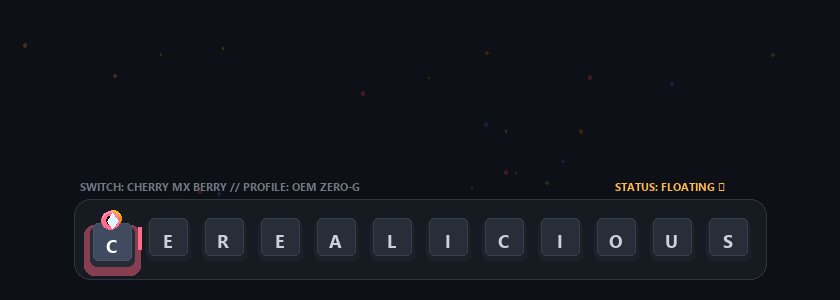

<div align="center">

  <!-- Header Banner: Zero-G Mechanical Keyboard & Popping Cereal -->
  <picture>
    <source media="(prefers-color-scheme: dark)" srcset="./assets/header.gif">
    <source media="(prefers-color-scheme: light)" srcset="./assets/header.gif">
    
  </picture>

  <br />

  <p align="center">
    <strong>IT Analyst</strong> &nbsp;•&nbsp; 
    <strong>Endpoint Infrastructure Specialist</strong> &nbsp;•&nbsp; 
    <strong>Enterprise Operations</strong>
  </p>

  <p align="center">
    <a href="https://ceriltalan.me"></a>
    <a href="#-nutrition-facts"></a>
    <a href="#-nutrition-facts"></a>
    <a href="#-nutrition-facts"></a>
    <a href="https://ceriltalan.me"></a>
  </p>

  <p align="center">
    <em>"Bridging enterprise systems and human connection with reliability, empathy, and zero unnecessary weight."</em>
  </p>

</div>

<hr />

## 🥣 Nutrition Facts

<table align="center" width="100%">
  <tr>
    <td align="left" style="padding: 24px;">

```
╔═══════════════════════════════════════════════════════════════════════════╗
║                             NUTRITION FACTS                               ║
║  Serving Size: 1 IT Analyst / Endpoint Infrastructure Specialist          ║
║  Servings Per Container: 9+ Years of Enterprise Problem-Solving           ║
╠═══════════════════════════════════════════════════════════════════════════╣
║  Amount Per Serving                                                       ║
║  Calories: 0 (Powered entirely by Earl Grey & Lubed Mechanical Keycaps)   ║
╠═════════════════════════════════════════════════════════════╦═════════════╣
║                                                             ║ % Daily Val*║
╠═════════════════════════════════════════════════════════════╬═════════════╣
║  Human-First Mindset & User Empathy                         ║        100% ║
║  First-Contact Resolution (FCR Rate)                        ║         90% ║
║  Enterprise Queue Performance (Ontario Gov / OPS Peak)      ║      253.7% ║
║  Cloud Endpoint Provisioning (Intune & Autopilot Group Tags)║         98% ║
║  Mobile Device Management (Jamf Pro & Workspace ONE UEM)    ║         95% ║
║  Identity & Access Governance (Active Directory / IAM)      ║         96% ║
║  People Trained, Mentored & Supported (Educators & Peers)   ║       100+  ║
║  Multi-Platform Diagnostics (Windows, macOS, iOS, Android)  ║         99% ║
║  "Have you tried restarting your endpoint?"                 ║        250% ║
║  Patience with Executive TechLounge & Hardware Jams         ║        120% ║
╠═════════════════════════════════════════════════════════════╩═════════════╣
║  Fortified with Essential Enterprise Vitamins:                            ║
║  • Vitamin A (Autopilot, Intune & Cloud Provisioning)                     ║
║  • Vitamin B (Active Directory, IAM & Group Policy Security)              ║
║  • Vitamin C (Citrix Workspace, VMware & Remote Desktop)                  ║
║  • Vitamin D (Documentation, SOPs & Technical Enablement)                 ║
╠═══════════════════════════════════════════════════════════════════════════╣
║  * Percent Daily Values are based on a 60,000+ enterprise user diet.      ║
╚═══════════════════════════════════════════════════════════════════════════╝
```

  <p>
    👋 <strong>Hey there! I'm Ceril Anthony Talan (<code>cerealicious</code>).</strong><br />
    Based in Toronto, ON, I have over <strong>9 years of enterprise and solutions experience</strong> specializing in cloud endpoint provisioning, identity governance, and user-first IT resolution. Finishing my final semester in the <em>Computer Systems Technician</em> program at <strong>Seneca Polytechnic</strong>, I focus on building infrastructure that pairs enterprise-grade reliability with genuine human connection.
  </p>
  <p>
    From managing multi-tier queues across 30 Ontario government ministries (peaking at <strong>253.7% efficiency</strong>) to deploying zero-touch configurations across Windows, macOS, and mobile devices, my goal is simple: <em>make complex technology intuitive, transparent, and completely dependable.</em>
  </p>

   </td>
  </tr>
</table>

<br />

## 🌾 Ingredients (Tech Stack)

> **INGREDIENTS**: Microsoft Intune, Windows Autopilot, Active Directory, Microsoft Azure, Microsoft 365, Identity & Access (IAM), Windows 11/10, macOS, Jamf Pro, Workspace ONE UEM, ServiceNow, BMC Remedy, eSMT, VMware, Citrix Workspace, Remote Desktop, Git Versioning, Microsoft Copilot, Google Gemini, Naturally Flavored Earl Grey (2%), Zero-G Marshmallows (1%).

<br />

### ☁️ Whole Grains &middot; Cloud Endpoints, Identity & Governance
<p>
  
  
  
  
  
  
  
  
</p>

### 🖥️ Fortified Minerals &middot; Platforms & Virtualization
<p>
  
  
  
  
  
  
  
  
</p>

### 🎫 Sweeteners & Crunch &middot; ITSM Platforms & Modern Workflow
<p>
  
  
  
  
  
  
  
</p>

<br />

## 🎁 Toy Inside the Box (Personal Records &amp; Real Stats)

<div align="center">

| Fun Metric | Verified Record | Context &amp; Details |
| :--- | :--- | :--- |
| ⚡ **Peak Queue Efficiency** | **253.7%** | Ontario Government incident resolution across 30 ministries (60k+ users) |
| 🎯 **First-Contact Resolution** | **90% FCR** | Enterprise client frontline support (Insight) |
| 👥 **People Empowered** | **100+ Users & Peers** | Educators trained in remote workflows + incoming analysts mentored |
| ⌨️ **Daily Driver Keycaps** | **Custom Mechanical Keyboards** | Crisp linear & tactile feedback (check the interactive keys on my website!) |
| 🍵 **Fuel Economy** | **3 Mugs Earl Grey / Day** | Clean energy for zero-touch cloud provisioning |

</div>

<br />

## 🥛 Pour Yourself a Bowl (Contact)

Have an enterprise infrastructure role, IT systems challenge, or collaboration in mind? Let's connect!

<p align="center">
  <a href="mailto:cereals.aroma948@simplelogin.com">
    
  </a>
  &nbsp;
  <a href="https://discord.com/users/487470641692278784">
    
  </a>
  &nbsp;
  <a href="https://ceriltalan.me">
    
  </a>
</p>

<br />

<div align="center">
  <sub>Crafted with milk, mechanical switches, and zero gravity for <strong>cerealicious</strong> &bull; Visual Studio &bull; 2026</sub>
</div>
